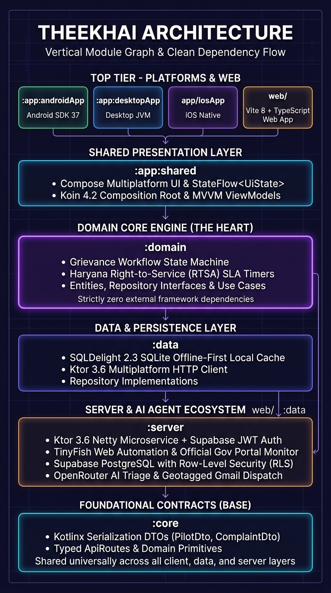
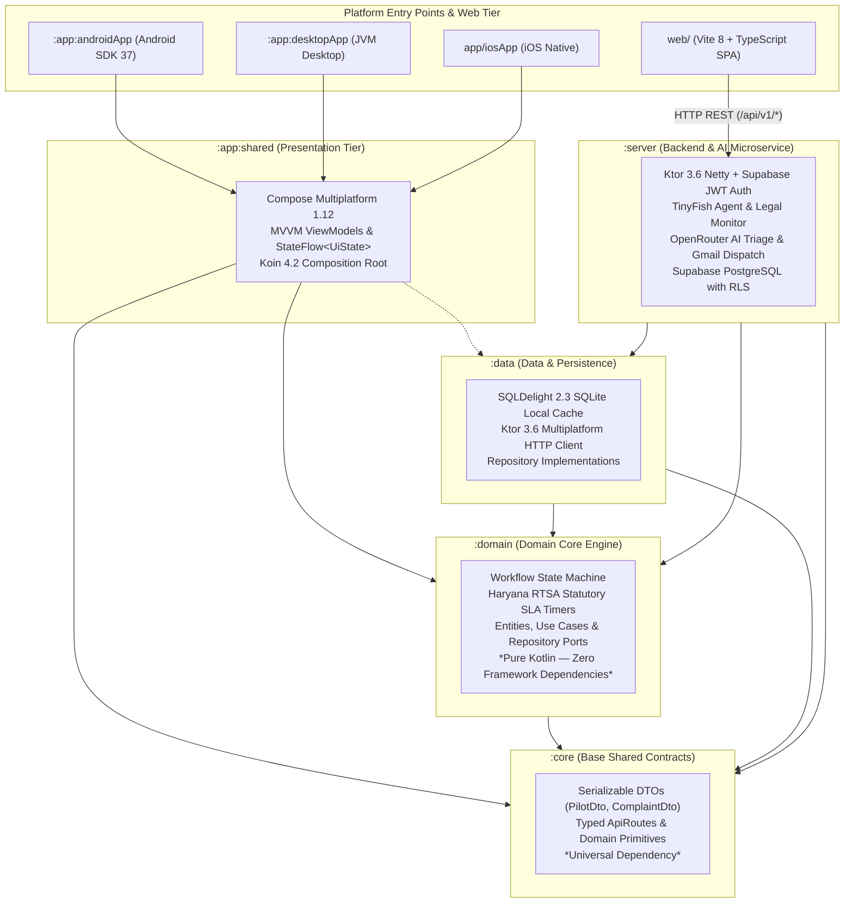

# Architecture

**TheekHai** follows **Clean Architecture + MVVM** with **Kotlin Multiplatform (KMP)**, **Compose Multiplatform**, **Koin** dependency injection, **SQLDelight** local/server SQLite databases, an authoritative **Ktor** backend, a **Vite + TypeScript** web application (`web/`), **Supabase Auth & PostgreSQL Row-Level Security (RLS)** (`TheekHai` — `ffmcurazxvygsifbglwy`), and **TinyFish + OpenRouter + Tavily** for official legal discovery, monitoring, and AI triage.

See [agent.md](agent.md) and the project guides in [docs/](docs/) for detailed security, database, API, and design specifications.

---

## 1. Module Graph (Vertical Inward Dependency Flow)



```
 +-----------------------------------------------------------------------------------+
 |                             PLATFORMS & WEB CLIENTS                               |
 |   :app:androidApp       :app:desktopApp         app/iosApp         web/ (Vite+TS) |
 +-----------+--------------------+--------------------+--------------------+--------+
             |                    |                    |                    |
             +--------------------+--------------------+                    |
                                  |                                         |
                                  v                                         |
 +-----------------------------------------------------------------+        |
 |             :app:shared (Presentation & Compose UI)             |        |
 |   Compose Multiplatform MVVM • StateFlow<UiState> • Koin 4.2    |        |
 +------------------+------------------------------+---------------+        |
                    |                              |                        |
                    | (calls use cases)            v                        |
                    |             +--------------------------------+        |
                    |             |     :data (Local/Remote)       |        |
                    |             |  SQLDelight SQLite • Ktor Http |        |
                    |             +----------------+---------------+        |
                    v                              |                        |
 +-------------------------------------------------+---------------+        |
 |                :domain (Domain Core Engine)                     |        |
 |   Workflow State Machine • Haryana RTSA SLA Timers • Ports      |        |
 |   *Pure Kotlin — Zero Framework Dependencies (Inward Only)*     |        |
 +--------------------------------+--------------------------------+        |
                                  ^                                         |
                                  |                                         v
 +--------------------------------+------------------------------------------+
 |               :server (Backend & AI Agent Ecosystem)                     |
 |   Ktor 3.6 Netty • Supabase JWT Auth • TinyFish Agent • OpenRouter AI    |
 +--------------------------------+-----------------------------------------+
                                  |
                                  v
 +--------------------------------------------------------------------------+
 |                      :core (Base Shared Contracts)                       |
 |   Kotlinx Serialization DTOs (PilotDto, ComplaintDto) • Typed ApiRoutes  |
 |   *Shared Universally Across All Modules*                                |
 +--------------------------------------------------------------------------+
```



| Module | Layer | May depend on | Must NOT depend on |
|---|---|---|---|
| `:core` | Shared contract (`PilotDto.kt`, `ComplaintDto.kt`, `ApiRoutes.kt`) | `kotlinx.serialization` | Any other module |
| `:domain` | `Workflow` engine, entities, repository interfaces, use cases | `kotlinx.coroutines` | `:data`, UI, Ktor, SQLDelight, Koin |
| `:data` | Repository implementations, SQLDelight (`Pilot.sq`), Ktor client (`OpenRouterApiClient`, `TinyFishApiClient`) | `:domain`, `:core` | `:app:*`, Compose |
| `:app:shared` | ViewModels (`StateFlow<UiState>`), Compose UI, Koin composition root | `:domain`, `:core`, `:data` (in `di/` only) | `:server` |
| `:app:*App` | Platform entry points (`androidApp`, `desktopApp`, `iosApp`) | `:app:shared` | `:data` directly |
| `:server` | Ktor Netty routes (`Application.kt`), `SupabaseJwtAuth`, `LegalService` | `:domain`, `:data`, `:core` | `:app:*` |
| `web/` | Browser-native Vite + TypeScript SPA consuming `/api/v1/*` | Web DOM / Fetch API | KMP SQLite directly |

---

## 2. Presentation & MVVM (`:app:shared` & `web/`)

- **Native Clients (`:app:shared`):** `Screen (Composable)` observes `StateFlow<UiState>` from a `ViewModel`, which calls **domain use cases only**. Screens are split into stateful `*Route` (obtaining the `ViewModel` via `koinViewModel()`) and stateless `*Screen` composables.
- **Web Client (`web/`):** Built with Vite + TypeScript (`src/main.ts`, `src/screens.ts`, `src/api.ts`, `src/ui.ts`, `src/style.css`), providing bilingual (`en`/`hi`) views for Overview (`/`), Report Intake (`/report`), Workspace (`/workspace`), Case Detail (`/cases/:id`), Reference Library (`/library`), Authentication (`/login`, `/signup`), and Supabase RLS Account (`/account`).

---

## 3. Dependency Injection (Koin)

- `:domain` has no DI framework dependency; use cases are registered in `app/shared/.../di/AppModule.kt` (`domainModule`).
- `:data` exposes `dataModule`, `localDataModule`, `remoteDataModule`, and `expect val platformDataModule` (actuals provide the platform `SqlDriver` and backend base URL).
- `initKoin { ... }` is called by Android (`TheekHaiApplication`), Desktop (`main.kt`), and iOS (`startKoinForIos()` in `iOSApp.swift`).
- `:server` uses `koin-ktor` (`serverModule` in `server/.../di/ServerModule.kt`).

---

## 4. Dual-Layer Persistence: SQLDelight + Supabase PostgreSQL RLS

1. **SQLDelight (`Pilot.sq` + migrations `1.sqm`, `2.sqm`):**
   - Defines `PilotCase`, `PilotTask`, `PilotEvent`, `PilotReceipt`, `PilotLink`, `LegalSource`, and `LegalMonitor`.
   - Drivers: Android `AndroidSqliteDriver`, iOS `NativeSqliteDriver`, Desktop & Server `JdbcSqliteDriver`.
2. **Supabase PostgreSQL (`supabase/schema.sql` — Project `ffmcurazxvygsifbglwy`):**
   - Provides Supabase Auth (`/auth/v1/*`) and 7 RLS-enabled tables (`profiles`, `saved_sources`, `complaints`, `case_tasks`, `audit_logs`, `legal_sources`, `legal_monitors`) plus the private `evidence` Storage bucket.
   - Ktor's `SupabaseJwtAuth` verifies user sessions, enforces `HttpOnly` cookie + `X-CSRF-Token` (with `Bearer` token fallback), and syncs workflow changes to Supabase PostgREST using the user's JWT so PostgreSQL RLS policies are enforced on every query.

---

## 5. AI, Legal Library & Official Discovery (`LegalService.kt`)

- **TinyFish Agent Mode (`POST /v1/automation/run`) & Monitor Mode (`POST /v1/monitors`):** Primary engine for official page extraction, source-grounded legal Q&A (`TINYFISH_AGENT`), and scheduled change detection.
- **Tavily Official-Domain Search (`POST /search`):** Discovers and verifies content exclusively from allowlisted official hosts (`indiacode.nic.in`, `haryana-rtsc.gov.in`, `aas.saralharyana.nic.in`, `efiling.ecourts.gov.in`, `informatics.nic.in`).
- **OpenRouter AI (`POST /api/v1/chat/completions`):** Powers complaint intake triage & duplicate detection (`POST /api/v1/complaints/triage`) and secondary source-grounded legal synthesis (`TAVILY_AND_OPENROUTER` / `OPENROUTER_SYNTHESIS`).
- **Deterministic Local Backup (`SOURCES_ONLY` & `LOCAL_RULE_FALLBACK`):** Guarantees offline resilience and zero hallucinated legal or workflow outcomes when external APIs are unreachable.
