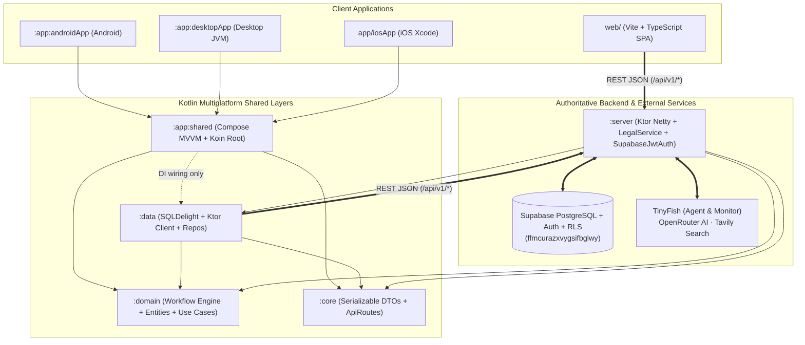

# TheekHai — Accountable Civic Grievance, Legal Reference & Multiplatform Pilot

**TheekHai** (`ठीकहै`) is a bilingual (**English / हिन्दी**) civic issue reporting, departmental coordination, independent closure verification, and source-grounded legal reference platform built with **Kotlin Multiplatform (KMP)**, **Compose Multiplatform**, a common **Ktor** backend, a **Vite + TypeScript** citizen/staff web application, **SQLDelight**, **Supabase Auth & PostgreSQL Row-Level Security (RLS)**, **TinyFish (Agent & Monitor Mode)**, **OpenRouter AI**, and **Tavily Official-Domain Search**.

---

## 1. Key Capabilities

- **Bilingual Citizen & Staff Web Workspace (`web/`):**
  - **English (`en`) & Hindi (`हिन्दी`)** across navigation, forms, status pills, dates, and legal guidance.
  - **Report Intake (`/report`):** Text & voice recording with editable transcripts, geolocation/address capture, local device draft saving, and **OpenRouter AI Triage & Duplicate Detection** (`POST /api/v1/complaints/triage`).
  - **Role-Based Workspaces (`/workspace` & `/cases/:id`):** Citizen tracking, Department task queues, Independent Reviewer closure verification, citizen closure challenges (`CHALLENGE`), and reviewer-upheld reopenings (`REOPEN`).
  - **Supabase Account & RLS Bookmarks (`/login`, `/signup`, `/account`):** Inspired by TenderLens—includes 1-click shared demo roles, password visibility toggle, 3-bar password strength meter, password recovery, RLS-protected user profiles (`public.profiles`), and bookmarked legal references (`public.saved_sources`).
- **Authoritative Case Lifecycle & Separation of Duties (`:domain` & `:server`):**
  - Lifecycle: `SUBMITTED → ASSIGNED → IN_PROGRESS → PENDING_VERIFICATION → CLOSED` (with `REOPENED` on upheld citizen challenge).
  - **Strict Separation of Duties:** Required departmental tasks must be completed before closure can be requested (`REQUEST_CLOSURE`), and the staff member requesting closure **cannot** approve their own closure (`APPROVE_CLOSURE` / `REJECT_CLOSURE` requires an independent `REVIEWER` or `ADMIN`).
  - **Durable SLA Deadlines:** Configurable pilot service targets (Critical: 4h, High: 24h, Medium: 72h, Low: 7d) with idempotent warning (`SLA_WARNING` at 75%), breach (`SLA_BREACH`), and 24h escalation (`SLA_ESCALATION`) recovery across server restarts.
- **4-Tier Source-Grounded Legal Reference & Monitoring (`/library`):**
  - Installed **Central** and **Haryana (Right to Service Act & Auto Appeal System — AAS)** bilingual reference packs.
  - **TinyFish Agent Mode (`/v1/automation/run`):** Extracts and synthesizes answers grounded strictly in approved official sources (`TINYFISH_AGENT`).
  - **TinyFish Monitor Mode (`/v1/monitors`):** Tracks official government pages (`fetch`) and civic topics (`search`) on cron schedules, queuing any changed material as `PENDING` for human reviewer approval without overwriting `APPROVED` guidance.
  - **OpenRouter + Tavily Fallback (`TAVILY_AND_OPENROUTER` / `TAVILY_FALLBACK`):** Official-domain search restricted to allowlisted `.gov.in` / `.nic.in` hosts via Tavily (`/search`) combined with OpenRouter (`/chat/completions`) source-grounded synthesis.
  - **Deterministic Local Backup (`SOURCES_ONLY`):** Always returns approved passages directly from SQLDelight SQLite if external providers are offline or ungrounded.

---

## 2. Technology Stack

| Layer | Technology | Purpose |
| --- | --- | --- |
| **Shared Contracts (`:core`)** | Kotlin Multiplatform, `kotlinx.serialization` | Serializable REST DTOs (`PilotDto.kt`, `ComplaintDto.kt`) and API route constants (`ApiRoutes.kt`) shared across Server, Android, iOS, and Desktop |
| **Domain Layer (`:domain`)** | Pure Kotlin Multiplatform, `kotlinx.coroutines` | Core workflow engine (`Workflow.kt`), entities, repository interfaces, and use cases (zero UI/DB/network dependencies) |
| **Data Layer (`:data`)** | SQLDelight (`2.3.2`), Ktor Client (`3.4.2`), Koin | Cross-platform SQLite persistence (`Pilot.sq` + migrations `1.sqm`, `2.sqm`), remote data sources, and `OpenRouterApiClient` / `TinyFishApiClient` |
| **Mobile & Desktop UI (`:app:shared`, `:app:androidApp`, `:app:desktopApp`, `app/iosApp`)** | Compose Multiplatform (`1.10.3`), Material 3, AndroidX Lifecycle ViewModel, Koin Compose | Shared MVVM presentation (`StateFlow<UiState>`) for Android, Desktop JVM, and iOS |
| **Web Application (`web/`)** | Vite (`8.x`), TypeScript (`5.9`), Semantic HTML5/CSS3, Playwright | Bilingual (`en`/`hi`) responsive citizen, department, reviewer, and legal library web app |
| **Backend Server (`:server`)** | Ktor Server (`3.4.2`, Netty), Koin Ktor, SQLDelight JDBC SQLite | Authoritative workflow engine, session & CSRF security, Supabase JWT/PostgREST bridge, and background SLA/Monitor workers |
| **Authentication & Cloud DB** | **Supabase** (`TheekHai` — `ffmcurazxvygsifbglwy`) | Supabase Auth (`/auth/v1/*`), PostgreSQL with Row-Level Security (`profiles`, `saved_sources`, `complaints`, `case_tasks`, `audit_logs`, `legal_sources`, `legal_monitors`), and private `evidence` Storage bucket |
| **AI & Official Discovery** | **TinyFish** (`Agent` & `Monitor`), **OpenRouter** (`openrouter/free` by default), **Tavily** (`/search`) | Official source discovery, page/topic change monitoring, source-grounded legal Q&A, and AI complaint intake triage & duplicate detection |

---

## 3. Architecture & Module Boundaries

The repository strictly enforces **Clean Architecture + MVVM** with inward-pointing dependencies:



| Module | Responsibility | Allowed Project Dependencies |
| --- | --- | --- |
| [`:core`](file:///d:/TheekHai/core) | Serializable DTOs (`PilotDto.kt`), `ApiRoutes` constants | *None* (`kotlinx.serialization` only) |
| [`:domain`](file:///d:/TheekHai/domain) | `Workflow` state machine, domain entities, repository ports, use cases | *None* (`kotlinx.coroutines` only) |
| [`:data`](file:///d:/TheekHai/data) | SQLDelight schemas (`Pilot.sq`, `Greeting.sq`), Ktor HTTP clients, repository implementations | `:domain`, `:core` |
| [`:app:shared`](file:///d:/TheekHai/app/shared) | Compose Multiplatform screens, `ViewModel`s (`StateFlow<UiState>`), client Koin composition root | `:domain`, `:core`, `:data` *(restricted to `di/`)* |
| [`:app:androidApp`](file:///d:/TheekHai/app/androidApp) | Android application entry point, permissions & manifest | `:app:shared` |
| [`:app:desktopApp`](file:///d:/TheekHai/app/desktopApp) | Desktop (JVM) application entry point | `:app:shared` |
| [`app/iosApp`](file:///d:/TheekHai/app/iosApp) | iOS SwiftUI host project invoking `startKoinForIos()` | `:app:shared` |
| [`:server`](file:///d:/TheekHai/server) | Ktor HTTP server (`Application.kt`), `SupabaseJwtAuth`, `LegalService` | `:domain`, `:data`, `:core` |
| [`web/`](file:///d:/TheekHai/web) | Browser-native Vite + TypeScript frontend consuming `/api/v1/*` | Independent web package |

---

## 4. Database & Security Architecture

### 4.1 Local & Server SQLDelight Database (`Pilot.sq`)
- Each native client has its own local SQLite instance (`AndroidSqliteDriver`, `NativeSqliteDriver`, `JdbcSqliteDriver`) for offline-first observation and drafts.
- The Ktor server maintains the authoritative workflow SQLite database (`theekhai-server.db` via `Pilot.sq` with migrations `1.sqm` and `2.sqm`):
  - `PilotCase`, `PilotTask`, `PilotEvent`, `PilotReceipt` (idempotency keys), `PilotLink` (duplicate/related links), `LegalSource`, and `LegalMonitor`.

### 4.2 Supabase Auth & PostgreSQL RLS (`supabase/schema.sql`)
Connected to live Supabase project **`TheekHai` (`ffmcurazxvygsifbglwy`)** with 7 RLS-protected tables in `public`:
1. `public.profiles` — User identity, `role` (`CITIZEN`, `DEPARTMENT`, `REVIEWER`, `ADMIN`), `department`, `organization`, `ward`, and `preferred_language`, guarded by `protect_profile_role()` trigger to prevent privilege escalation.
2. `public.saved_sources` — Per-user bookmarked legal/civic passages (`(select auth.uid()) = user_id`).
3. `public.complaints` — Synchronized civic cases with status, priority, coordinates, and SLA deadlines.
4. `public.case_tasks` — Coordinated departmental tasks per case.
5. `public.audit_logs` — Append-only audit trail of every workflow transition.
6. `public.legal_sources` — Approved and pending Central & Haryana legal reference passages.
7. `public.legal_monitors` — Active TinyFish Page (`fetch`) and Topic (`search`) monitors.

---

## 5. REST API Overview (`/api/v1`)

| Method & Route | Description |
| --- | --- |
| `GET /health` | Server health and live configuration status (`supabaseConfigured`, `tinyFishConfigured`, `tavilyConfigured`, `openRouterConfigured`) |
| `GET /api/v1/providers` | Returns `ProviderStatusDto` for UI integration badges |
| `POST /api/v1/auth/login` | Authenticates with Supabase Auth, sets `HttpOnly` session cookie (`theekhai_session`), and returns `accessToken` fallback |
| `POST /api/v1/auth/register` | Registers a citizen account in Supabase Auth and provisions `public.profiles` |
| `POST /api/v1/auth/recover` | Sends password recovery email via Supabase Auth |
| `GET /api/v1/auth/me` | Returns authenticated `IdentityDto` (`id`, `role`, `department`, `csrf`, `email`, `fullName`, `organization`, `ward`) |
| `GET / POST /api/v1/profile` | Reads or updates the user's RLS-protected `public.profiles` row in Supabase |
| `GET / POST / DELETE /api/v1/saved-sources` | Lists, bookmarks, or removes RLS-protected `public.saved_sources` rows |
| `GET /api/v1/complaints` | Lists visible cases filtered by role/ownership |
| `POST /api/v1/complaints/triage` | Runs **OpenRouter AI** intake triage, category/priority classification, and neighbourhood duplicate detection |
| `POST /api/v1/complaints` | Submits a report (`Idempotency-Key` protected) and syncs to Supabase PostgreSQL |
| `GET /api/v1/complaints/{id}` | Returns `CaseDetailDto` (`case`, `tasks`, `events`) |
| `POST /api/v1/complaints/{id}/actions` | Executes `START`, `ADD_TASK`, `COMPLETE_TASK`, `REQUEST_CLOSURE`, `APPROVE_CLOSURE`, `REJECT_CLOSURE`, `CHALLENGE`, or `REOPEN` |
| `GET /api/v1/legal/sources` | Searches approved Central/Haryana legal sources with bilingual glossary expansion |
| `POST /api/v1/legal/ask` | Answers civic/legal questions via `TINYFISH_AGENT` $\rightarrow$ `TAVILY_AND_OPENROUTER` $\rightarrow$ `TAVILY_FALLBACK` $\rightarrow$ `SOURCES_ONLY` |
| `POST /api/v1/legal/discover` | Discovers official `.gov.in`/`.nic.in` sources via Tavily + TinyFish Agent into the `PENDING` review queue |
| `GET / POST /api/v1/legal/monitors` | Lists or creates TinyFish Page (`fetch`) and Topic (`search`) monitors |
| `POST /api/v1/legal/monitors/{id}/run` | Triggers an immediate TinyFish monitor run and queues changed sources as `PENDING` |
| `POST /api/v1/legal/sources/{id}/review` | Reviewer approves (`APPROVED`, superseding prior version) or rejects (`REJECTED`) a pending source |

---

## 6. Environment Configuration & Demo Accounts

Create a `.env` file in the project root (automatically loaded by `EnvConfig` and ignored by Git):

```env
SUPABASE_URL= 
SUPABASE_PUBLISHABLE_KEY=
THEEKHAI_COOKIE_SECURE=false
TINYFISH_API_KEY="your-tinyfish-api-key"
OPENROUTER_API_KEY="your-openrouter-api-key"
TAVILY_API_KEY="your-tavily-api-key"
```

### Shared Pilot Demo Accounts (Password: `TheekHai@2026`)
Available via 1-click fill buttons on `http://localhost:5173/login`:

| Role | Email | Password | Capabilities |
| --- | --- | --- | --- |
| **Citizen (Ward 4)** | `citizen@theekhai.in` | `TheekHai@2026` | Submit reports, track Ward 4 cases, challenge closures, bookmark legal sources |
| **Department Staff** | `pwd@theekhai.in` | `TheekHai@2026` | Start assigned Public Works cases, add/complete tasks, request closure review |
| **Independent Reviewer** | `reviewer@theekhai.in` | `TheekHai@2026` | Approve/reject closure requests, uphold citizen challenges, run TinyFish monitors & approve legal sources |
| **Operations Admin** | `admin@theekhai.in` | `TheekHai@2026` | Full operational oversight across all cases, departments, monitors, and source queues |

---

## 7. Running & Testing the Project

### 1. Start the Ktor Backend Server (`http://localhost:8080`)
```powershell
.\gradlew.bat :server:run
```

### 2. Start the Web Application (`http://localhost:5173`)
```powershell
cd web
npm install
npm run dev
```

### 3. Run Native Clients (Android / Desktop / iOS)
- **Desktop (JVM):** `.\gradlew.bat :app:desktopApp:run`
- **Android Debug APK:** `.\gradlew.bat :app:androidApp:assembleDebug`
- **iOS:** Open [`app/iosApp`](file:///d:/TheekHai/app/iosApp) in Xcode.

### 4. Run Tests & Production Builds
```powershell
# Run all JVM unit & integration tests (:domain, :data, :app:shared, :server)
.\gradlew.bat :domain:jvmTest :data:jvmTest :app:shared:jvmTest :server:test

# Type-check and build the production web bundle
cd web && npm run build
```

---

## 8. Project Documentation Index

- [Architecture Guide (`ARCHITECTURE.md`)](file:///d:/TheekHai/ARCHITECTURE.md)
- [Maintainer & Agent Guide (`agent.md`)](file:///d:/TheekHai/agent.md)
- [Security & RLS Guide (`docs/SECURITY.md`)](file:///d:/TheekHai/docs/SECURITY.md)
- [Database & Migrations (`docs/DATABASE.md`)](file:///d:/TheekHai/docs/DATABASE.md)
- [REST API Contract (`docs/API.md`)](file:///d:/TheekHai/docs/API.md)
- [Web Design System (`docs/DESIGN_SYSTEM.md`)](file:///d:/TheekHai/docs/DESIGN_SYSTEM.md)
- [Legal Channels & Integrations (`docs/LEGAL_AND_INTEGRATIONS.md`)](file:///d:/TheekHai/docs/LEGAL_AND_INTEGRATIONS.md)
- [Code Style Guide (`docs/CODE_STYLE.md`)](file:///d:/TheekHai/docs/CODE_STYLE.md)
